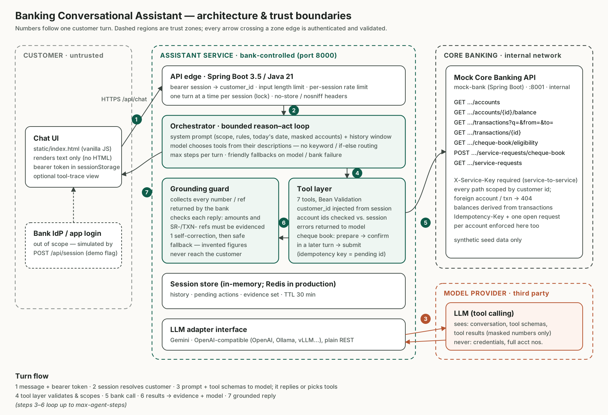

# Banking Conversational Assistant

[](https://github.com/realraghavrajsingh/bank-conversational-assistant/actions/workflows/ci.yml)

A conversational assistant, built with **Java 21 and Spring Boot 3.5**. An already-authenticated bank customer can use it, in natural language, to:

1. **Check a balance**: "how much have I got in savings?"
2. **Get a debit explained**: "what's that RZP*TECHNOVA charge?", "why did Uber charge me twice?"
3. **Order a cheque book**: a service request is raised and confirmed with a reference number.

An LLM reasons about each request and chooses among banking tools. Every balance, transaction and confirmation shown comes from the mocked core-banking service. A server-side grounding guard enforces that rule; the prompt alone does not.



---

## Quick start

**Prerequisites:** JDK 21, Maven 3.9+, and one LLM option:
- a Gemini API key (free at https://aistudio.google.com/apikey),
- an OpenAI key, or
- a local Ollama.

```bash
git clone https://github.com/realraghavrajsingh/bank-conversational-assistant.git
cd bank-conversational-assistant
cp .env.example .env          # set GEMINI_API_KEY (or switch provider, see below)

mvn verify                    # build + all tests (~1 min)
make bank                     # terminal 1: mock core banking on :8001
make assistant                # terminal 2: assistant API + chat UI on :8000
```

Open http://localhost:8000, pick a demo customer and start chatting.

Without `make`:

```bash
java -jar mock-bank/target/mock-bank-exec.jar
java -jar assistant/target/assistant.jar
```

**With Docker:** run `cp .env.example .env`, set your key, then `docker compose up --build`. Only the assistant is published (port 8000); the mock bank sits on the internal Compose network.

### Choosing a model

| Provider | `.env` |
|---|---|
| Gemini (default) | `LLM_PROVIDER=gemini`, `GEMINI_API_KEY=…`, `GEMINI_MODEL=gemini-3.8-flash` |
| OpenAI | `LLM_PROVIDER=openai`, `OPENAI_API_KEY=…`, `OPENAI_MODEL=gpt-5-mini` |
| Ollama / vLLM / any OpenAI-compatible endpoint | `LLM_PROVIDER=openai`, `OPENAI_BASE_URL=http://localhost:11434/v1`, `OPENAI_MODEL=qwen3:8b` |

The model must support tool (function) calling. If no model is configured, the service still starts: `/api/health` reports why, and chat returns a clear 503.

### Demo customers (synthetic)

| Customer | What to try |
|---|---|
| **Aarav Mehta** (CUST-1001): Savings XXXX4521, Current XXXX7788 | "what's my balance" (two accounts) · "and the amazon one yesterday?" · "what is RZP*TECHNOVA" · "why did uber charge me twice" · "what's the ₹500 deduction" · "send me a cheque book" → "yes" |
| **Priya Nair** (CUST-1002): Savings XXXX3192 | "send me a cheque book" → already has SR-700245, Dispatched |
| **Rohan Das** (CUST-1003): Basic Savings XXXX8812 | "send me a cheque book" → not eligible (BSBDA account) |

Tick **details** in the header to see which tools each reply used.

---

## Tests and evals

```bash
mvn verify      # all tests, offline, no API key needed
make eval       # real-model scenario evals against a running assistant
```

- **Unit and integration tests** use the real orchestrator, tools and guards, with the real mock bank started in-process over HTTP. Only the model is replaced by a scripted stand-in (`ScriptedLlmClient`), so the tests are deterministic. They cover:
  - the balance flow, and a debit follow-up after a balance check
  - a hallucinated figure being blocked and then corrected
  - cheque book confirmation enforced across turns, and idempotent retries
  - ineligible accounts and existing open requests
  - attempts to reach another customer's account or transaction
  - invalid tool arguments being returned to the model
  - model outage, bank outage and runaway tool loops
  - HTTP auth, input limits and rate limiting
  - wire-format translation for Gemini (including thought-signature round-trip) and OpenAI
- **Scenario evals** (`ScenarioEval`) check the actual model's reasoning:
  - varied phrasings and follow-ups
  - cryptic statement text and look-alike charges
  - the two-step cheque book flow
  - out-of-scope requests
  - a prompt-injection attempt against another customer's account

  Each turn asserts which tools were called, which were *not*, and what the reply must or must not contain.

CI (GitHub Actions) runs `mvn verify` on every push.

---

## Repository layout

```
pom.xml                         parent (Spring Boot 3.5, Java 21), modules below
mock-bank/                      mock core-banking API (port 8001)
  api/BankController            customer-scoped REST endpoints, X-Service-Key filter
  store/BankStore               in-memory system of record, seeded from seed.json
  resources/.../seed.json       synthetic customers, accounts, enriched transactions
assistant/                      conversational backend + UI (port 8000)
  web/                          HTTP API: session, chat, health; security headers
  agent/Agent                   orchestrator: bounded reason-act loop, fallbacks
  agent/Prompts                 system prompt
  tools/BankingTools            7 tools: schemas, validation, scoping, 2-phase cheque book
  guard/Grounding               deterministic check that reply figures came from the bank
  session/                      sessions, pending actions, evidence, rate limiting
  bank/BankClient               RestClient for core banking
  llm/                          provider-neutral interface + Gemini and OpenAI-compatible adapters
  resources/static/index.html   minimal chat UI (no build step)
docs/                           architecture diagram (SVG + PNG)
```

### API (assistant)

| Method | Path | Notes |
|---|---|---|
| `POST` | `/api/session` | `{customer_id}` → `{token, display_name, expires_in}`. **Simulated** sign-in (see assumptions); disabled with `DEMO_LOGIN_ENABLED=false` |
| `POST` | `/api/chat` | `Authorization: Bearer <token>`, `{message}` → `{reply, outcome, turn, trace[]}` |
| `DELETE` | `/api/session` | sign out |
| `GET` | `/api/health` | liveness + model configuration status |

---

## Design notes

### Decomposition

The system is split along trust boundaries rather than features:

- **Chat UI** (untrusted). Renders text only and holds an opaque session token.
- **Assistant service** (bank-controlled). Owns identity binding, orchestration and every safety guarantee:
  - API edge: auth, limits, per-session serialisation
  - orchestrator: the reason-act loop
  - tool layer: the only path to banking data
  - grounding guard
- **Model provider** (third party). Proposes actions and wording. It is never trusted for facts or authority.
- **Core banking** (system of record, mocked). Enforces customer scoping, eligibility and idempotency on its own side as well (defence in depth).

### How a turn works

1. The UI posts the message with a bearer token. The session resolves to exactly one `customer_id`.
2. The orchestrator sends the system prompt, the conversation window and seven tool schemas to the model.
3. The model either answers or requests tool calls. Each call goes through three steps before it reaches core banking:
   - its arguments are deserialised into a typed record and checked with Bean Validation;
   - it is scoped: the customer id comes from the session, never from the model, and account ids are checked against the session's own accounts;
   - it is executed against core banking.
4. Results go back to the model, and every number and reference in them is recorded as **evidence** for the session.
5. Steps 2–4 loop up to `max-agent-steps` times. The final draft then goes through the grounding guard:
   - any currency amount or `SR-`/`TXN-` reference not present in the evidence triggers one silent self-correction;
   - if the next draft still fails, a safe fallback is returned instead.

Routing is done by the model choosing tools from their descriptions. There is no intent classifier and no keyword matching, so "what's left in my current account", "was I charged twice by Uber?" and "RZP*TECHNOVA??" all work. Follow-ups work because the full tool exchange stays in the conversation history.

### Key decisions and why

| Decision | Rationale |
|---|---|
| **A single agent with tools**, not multiple agents or an intent router | Three capabilities that share context (a debit question after a balance check) fit one reasoning loop. Multiple agents would add hand-off latency and lose context for no gain at this scope. New capabilities are added as tools. |
| **Invariants enforced in code, not only in the prompt** | Prompts are advisory. Identity scoping, write confirmation and grounding live in code. That is what lets the system promise that figures are never invented by the model. |
| **Deterministic grounding guard** | It is cheap, explainable, and catches the failure that matters most in banking: a confidently wrong number. Arithmetic happens in tools (`total_amount`), so legitimate figures always appear verbatim in the evidence. |
| **Two-phase cheque book order with a turn-gap check** | `prepare` returns a summary and a pending id. `submit` is rejected unless the customer has replied since the summary was shown. This stops the model, or text injected through a transaction descriptor, from proposing and executing in one step. The pending id is also the idempotency key, so retries never create duplicate orders. |
| **Own provider-neutral LLM interface over REST** (no SDK, no framework auto-tool-execution) | The orchestrator must run every tool itself to enforce the rules above, which frameworks that auto-execute tools make harder. Banks often mandate a specific provider or an on-prem model: Gemini and any OpenAI-compatible endpoint (including local Ollama) work by configuration. The raw Gemini content is replayed, so thought signatures survive multi-step tool use. |
| **Two Spring Boot services in one Maven build** | The mock bank is a separate service, so the trust boundary, the service-to-service auth and the network failure modes are real rather than simulated in-process. Tests start it in-process on a random port, so they still run fully offline. |
| **Scripted-model tests plus real-model evals** | Plumbing and guarantees are tested deterministically in CI. Reasoning quality is measured separately, because it is probabilistic and depends on the model. |

### Assumptions

- **Authentication happens upstream.** The customer is already signed in to the bank's app. `POST /api/session` stands in for exchanging the app's identity-provider token (e.g. OIDC) for a conversation session. It is a demo affordance behind a flag.
- The context is an Indian retail bank: INR; NEFT, UPI and NACH channels; cheque books of 25 leaves (free) or 50 leaves (₹118 incl. GST), delivered to the registered address in about 7 days.
- "Explain a debit" means explaining it from the bank's own transaction and enrichment data. Raising disputes, blocking cards and fraud handling are out of scope; the assistant points to the app or the helpline.
- Delivery is only to the registered address. Changing the address is a separate, higher-assurance journey.
- All data is synthetic. Dates are generated relative to service start, so "yesterday" and "last week" always resolve.

### Security considerations

- **Identity:** the model never chooses whose data to read. The customer id comes from the session, and account ids are checked against it. Core banking scopes again and returns 404 for another customer's resources, so it does not leak whether they exist.
- **Prompt injection:** tool data is labelled untrusted in the prompt. More importantly, injected text cannot get past the server-side controls. It cannot change identity, skip write confirmation, or slip an invented figure past the guard.
- **Data minimisation:** only masked account numbers and masked addresses ever leave core banking. The model provider never sees full account numbers or credentials.
- **Service-to-service auth:** the assistant authenticates to core banking with `X-Service-Key`, compared in constant time. In production this would be mTLS or workload identity. Core banking is not exposed publicly.
- **Edge controls:**
  - message length limit
  - per-session rate limit
  - session TTL
  - one in-flight turn per session
  - `Cache-Control: no-store`, CSP and `nosniff` headers
  - the UI renders replies as text, so there is no HTML injection
- **Logging** records tool names, outcomes and latency. It does not record message contents or balances.

### Failure handling

| Failure | Behaviour |
|---|---|
| Model timeout or error | Friendly fallback pointing to the app. History stays well-formed, so the next turn works. |
| Core banking down | The tool returns `bank_unavailable`. The model apologises, and the guard blocks any guessed figure (tested). |
| Model invents a figure or reference | One self-correction, then a safe fallback. Logged as `ungrounded_reply`. |
| Bad tool arguments | A structured error goes back to the model, which corrects itself (tested). |
| Runaway tool loop | Capped by `max-agent-steps`. |
| Duplicate submit or client retry | Idempotent at core banking, which also enforces one open request per account. |

### Next steps for production

- Persist sessions and pending actions in Redis, and run the assistant stateless behind a load balancer.
- Replace the demo login with an identity-provider token exchange (Spring Security resource server), and add step-up authentication for write actions.
- Add OpenTelemetry tracing per turn and per tool, with dashboards for containment rate, fallback rate, grounding-guard hits, latency and cost per conversation. These metrics tie back to the 390k-calls-a-month business case.
- Hand off to a human agent, with the transcript, when the assistant can't help or the customer asks for one.
- Run the scenario evals in CI against a pinned model version, and add red-team prompts and Hinglish phrasing.
- Stream responses (SSE) to improve perceived latency.
